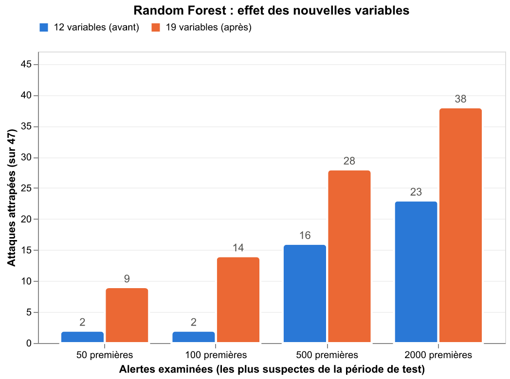

# Détection de comptes compromis et de mouvement latéral

Un attaquant qui se connecte avec un compte volé ne déclenche ni antivirus ni alerte
de mot de passe : pour le système, c'est un utilisateur légitime. Ce projet cherche
à le repérer à partir des seuls journaux d'authentification Windows, sur le jeu de
données public du Los Alamos National Laboratory (LANL) : 1,05 milliard
d'événements sur 58 jours, avec les actions d'une red team étiquetées.

## Résultats

Sur la période de test (jours 15 à 29), 47 journées compromises sont noyées parmi
113 336 couples (utilisateur, jour), soit 1 sur 2 400.

| Méthode | Alertes par jour | Journées compromises attrapées | Alertes justes |
|---|---|---|---|
| Random Forest, 10 alertes/jour | 10 | 14 / 47 (30 %, IC 95 % : 15-42 %) | 1 sur 11 |
| Random Forest, 100 alertes/jour | 100 | 31 / 47 (66 %, IC 95 % : 49-80 %) | 1 sur 48 |
| Random Forest, 250 alertes/jour | 250 | 38 / 47 (81 %) | 1 sur 100 |
| Règle "machine partagée + NTLM", version KQL | 206 | 38 / 47 (81 %) | 1 sur 81 |
| Isolation Forest (non supervisé), 50 alertes/jour | 50 | 7 / 47 | 1 sur 107 |
| `max_src_users` seul, 50 alertes/jour | 50 | 0 / 47 | - |

Les budgets sont appliqués jour par jour (les N couples les plus suspects de chaque
jour). IC 95 % : intervalle de confiance par bootstrap sur les comptes.
La règle "machine partagée" compte 246 alertes/jour dans sa version du notebook 05
et 206 dans sa version KQL corrigée (notebook 07).

- La précision moyenne du Random Forest est de 0,157 (IC 95 % : 0,069-0,268), soit
  378 fois le hasard. À volume d'alertes égal, il attrape autant d'attaques que la
  règle simple ; son apport est de classer les alertes pour réduire le volume.
- Quand un compte compromis est repéré, c'est presque toujours dès son premier jour
  compromis de la période de test (19 comptes sur 20 à 50 alertes/jour).
- Le signal décisif est `max_src_users` : le nombre de comptes différents qui se
  connectent le même jour depuis la machine source. L'attaquant rejoue ses
  identifiants volés depuis quelques machines, qui deviennent anormalement partagées
  (médiane de 32 comptes contre 1). Seule, elle ne trouve rien (les serveurs
  partagés légitimes passent devant) : c'est sa combinaison avec les autres
  variables qui détecte.
- Les méthodes non supervisées (Isolation Forest, k-means) trouvent l'inhabituel,
  pas l'attaquant : les comptes les plus extrêmes du réseau ne sont pas dans la red team.



## Méthode

Sept notebooks [marimo](https://marimo.io), un par étape :

| Notebook | Étape |
|---|---|
| `01_explore.py` | Exploration des données et des labels red team |
| `02_clean.py` | Nettoyage : comptes humains uniquement, `?` en NULL, export Parquet (202 M lignes) |
| `03_features.py` | 19 variables par (utilisateur, jour) : machines source et cibles, nouveauté, NTLM, partage de la machine source, écart à l'historique du compte |
| `04_labels.py` | Labels : 176 couples (utilisateur, jour) compromis |
| `05_detection.py` | Règles, Random Forest (`class_weight="balanced"`), Isolation Forest, k-means ; entraînement jours 1-10, validation jours 11-14 (choix des variables), test jours 15-29 (consulté une fois, modèle réentraîné sur 1-14) |
| `06_evaluation.py` | Rappel, précision, F1, courbe précision/rappel, budgets d'alertes jour par jour avec intervalles de confiance (bootstrap par compte), délai de détection, analyse des attaques ratées |
| `07_restitution.py` | Mapping MITRE ATT&CK, règles Sentinel, vérification de la logique KQL sur les données |

Le fichier compressé de 7 Go n'est jamais chargé en mémoire : DuckDB le lit en flux
et le parcourt en une minute environ.

## Détection en production

- `detection/mitre_mapping.md` : T1078 (Valid Accounts), T1550.002 (Pass the Hash),
  T1021.002 (SMB/Windows Admin Shares), correspondance des champs LANL vers
  l'événement Windows 4624 et la table `SecurityEvent`.
- `detection/sentinel/` : deux règles d'analyse planifiées (format YAML du dépôt
  communautaire Azure-Sentinel ; l'import par le portail demande un modèle ARM en
  JSON) et une requête de chasse KQL. Compte identifié par `domaine\compte`, machine
  source par adresse IP (le nom de poste NTLM est falsifiable), connexions de type
  3 et 10, exécution quotidienne, période d'analyse de 14 jours au plus (limite
  Sentinel). Leur logique a été rejouée en SQL sur les données
  LANL ; elles n'ont pas été exécutées sur un espace de travail Sentinel réel.
- Complément, pas remplacement, de Microsoft Defender for Identity, qui détecte
  déjà le pass-the-hash sur les contrôleurs de domaine : ces règles n'utilisent que
  les journaux du SIEM et s'expliquent variable par variable. Microsoft recommande
  désormais les *custom detections* de Defender XDR pour les nouvelles règles.

## Limites

- Les labels ne couvrent que ce que la red team a déclaré : un couple "normal"
  n'est pas garanti sain.
- Données de 2015, d'un seul environnement (LANL), anonymisées, sans heure réelle.
- Les attaques discrètes (une connexion dans une journée chargée) échappent à
  l'approche par (utilisateur, jour), tout comme les jours où l'attaquant n'utilise
  qu'un ou deux comptes.
- La détection fonctionne en bilan de fin de journée : le partage d'une machine est
  compté sur la journée entière. Pour du temps réel, il faudrait une fenêtre glissante.
- Une connexion NTLM est un indice compatible avec le pass-the-hash, pas une preuve :
  le jeu de données ne précise pas les techniques de la red team.
- La première version des variables a été conçue en partie en analysant une erreur
  sur un jour de test. Une période de validation (jours 11-14) confirme que l'idée était
  trouvable sans le test, mais avec un gain plus modeste : les chiffres du test sont
  une borne haute.
- Une référence calculée sur l'historique peut être contaminée par l'attaquant
  s'il est présent dès le début (démontré dans `05_detection.py`).

## Lancer le projet

```bash
git clone https://github.com/hadimouter/lanl-lateral-movement-detection.git
cd lanl-lateral-movement-detection
python3.12 -m venv .venv
.venv/bin/pip install -r requirements.txt
```

### En une minute, sans les données brutes

`sample/dataset_user_day.parquet` (11 Mo) contient les 19 variables et les labels des
440 972 couples (utilisateur, jour). Il suffit pour lancer la détection et l'évaluation :

```bash
.venv/bin/marimo edit notebooks/05_detection.py
.venv/bin/marimo edit notebooks/06_evaluation.py
```

Les parties qui demandent les données brutes (un graphique du 05, la vérification
KQL du 07) sont alors sautées avec un message.

### Le projet complet

Prérequis : environ 12 Go d'espace disque.

Télécharger `auth.txt.gz` et `redteam.txt.gz` sur
[csr.lanl.gov/data/cyber1](https://csr.lanl.gov/data/cyber1/) et les placer dans `data/`.
Puis ouvrir les notebooks dans l'ordre :

```bash
.venv/bin/marimo edit notebooks/01_explore.py
```

Les étapes 2 et 3 ont un bouton qui lance les calculs longs et écrit les fichiers
Parquet utilisés par la suite. Les modèles sont reproductibles (`random_state=0`).

## Données

Alexander D. Kent, *Comprehensive, Multi-Source Cyber-Security Events*,
Los Alamos National Laboratory, 2015.
[doi:10.17021/1179829](http://dx.doi.org/10.17021/1179829). Licence CC0 1.0.
Le fichier `sample/dataset_user_day.parquet` est dérivé de ces données.

## Auteur

Hadi Mouter
