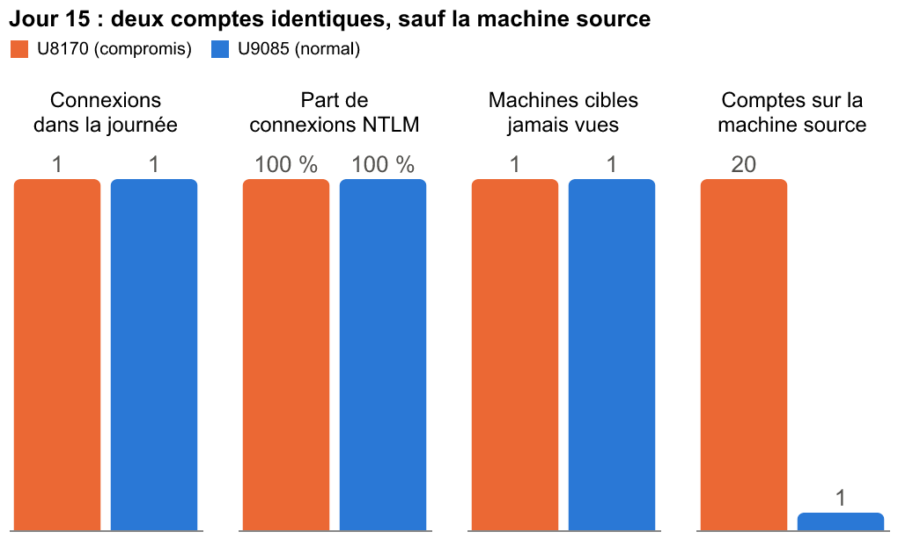
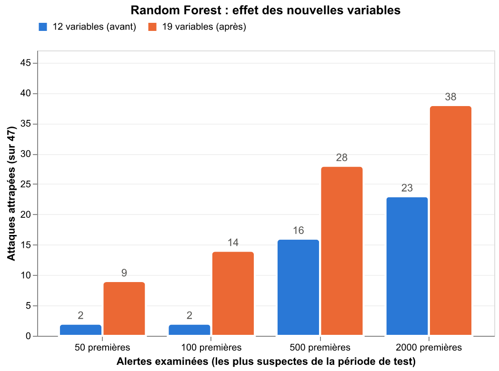
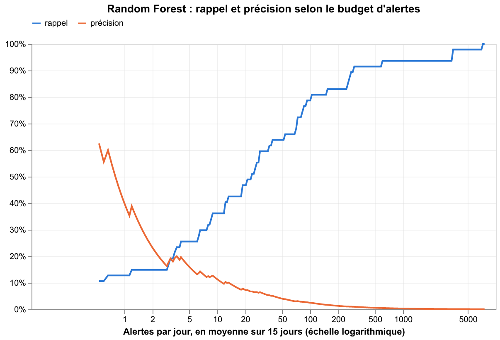
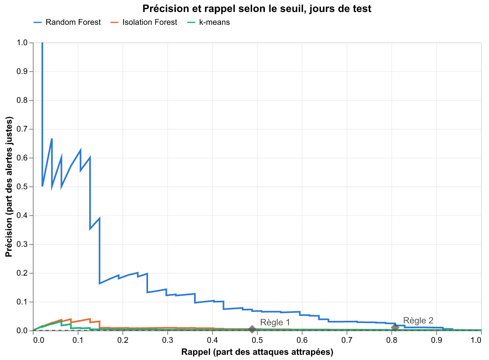
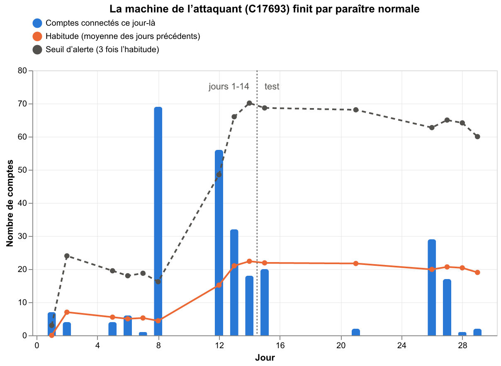

# Repérer un compte volé dans un milliard de connexions

*Ce que j'ai appris en cherchant du mouvement latéral dans les journaux d'authentification du Los Alamos National Laboratory.*

Le quinzième jour de la collecte, le compte U8170 se connecte une seule fois. Une connexion réseau, en NTLM, vers une machine qu'il n'avait jamais utilisée. Rien d'autre de la journée. Ce n'était pas son propriétaire : c'était une équipe d'attaque qui utilisait son identifiant volé. Le même jour, le compte U9085 fait exactement la même chose, une connexion en NTLM vers une machine nouvelle, et lui est parfaitement légitime.

Comment les distinguer ? C'est toute la question de cet article. Je l'ai écrit pour les équipes de sécurité, mais aussi pour ceux qui n'ont jamais touché à l'intelligence artificielle : chaque notion technique est expliquée dans un encart « En clair » que les spécialistes peuvent sauter, et un glossaire reprend tous les termes à la fin.

## Le problème : un compte volé ne déclenche rien

Quand un attaquant vole le mot de passe d'un utilisateur, il ne force aucune porte. Il se connecte. L'antivirus ne voit pas de fichier malveillant, le contrôleur de domaine voit une authentification réussie, le pare-feu voit un échange entre deux machines du réseau interne. Pour chacun de ces outils, tout est normal.

C'est ce qui rend le mouvement latéral si difficile à détecter. Après avoir compromis un premier poste, l'attaquant récupère les identifiants stockés en mémoire et les rejoue pour se déplacer de machine en machine, jusqu'à trouver un compte à privilèges ou les données qu'il cherche. Le référentiel MITRE ATT&CK, qui catalogue les techniques d'attaque connues, range ce comportement sous plusieurs entrées : l'usage de comptes valides (T1078), le pass-the-hash (T1550.002), les connexions aux partages administratifs Windows (T1021.002).

> *En clair : NTLM, Kerberos et le pass-the-hash.* Dans un réseau Windows, deux protocoles servent à prouver son identité. Kerberos est le protocole moderne, utilisé par défaut. NTLM est plus ancien et a une faiblesse connue : il suffit de posséder l'empreinte du mot de passe (le « hash »), pas le mot de passe lui-même, pour se connecter. Un attaquant qui récupère ces empreintes sur une machine compromise peut donc s'en servir directement, sans jamais connaître le mot de passe. C'est le pass-the-hash. Une connexion NTLM inhabituelle est donc un indice intéressant, mais pas une preuve : beaucoup d'applications légitimes utilisent encore NTLM, et le jeu de données ne dit pas quelle technique la red team a employée.

La seule trace que laisse l'attaquant, c'est la forme de son activité. Un employé se connecte depuis son poste, vers les serveurs qu'il utilise tous les jours. Un attaquant se connecte depuis des machines inhabituelles, vers des machines qu'il découvre, avec des protocoles que la victime n'utilise pas. J'ai voulu savoir jusqu'où on peut aller en ne regardant que ces journaux de connexion, avec des méthodes simples et explicables.

## Les données : 58 jours d'un vrai réseau, avec une vraie red team

Le Los Alamos National Laboratory, un laboratoire de recherche américain, a publié en 2015 un jeu de données rare : 58 jours consécutifs d'événements de son réseau interne, anonymisés, dont 1,05 milliard d'authentifications. Chaque ligne indique quel compte se connecte, depuis quelle machine, vers quelle machine, avec quel protocole, et si la connexion a réussi. Pendant la collecte, une red team a mené des attaques réelles sur ce réseau. Ses 749 connexions sont listées dans un fichier séparé.

> *En clair : red team et labels.* Une red team est une équipe autorisée à attaquer un système pour en tester les défenses. Ici, elle a noté chacune de ses connexions. Ces notes sont des « labels » : la bonne réponse, que l'on cache aux méthodes de détection puis que l'on utilise pour vérifier si elles ont trouvé les attaques. Sans labels, impossible de savoir si une détection marche.

Le fichier fait 7 Go compressé. Je ne l'ai jamais chargé en mémoire : l'outil DuckDB lit le fichier compressé morceau par morceau et le parcourt entièrement en un peu plus d'une minute sur un ordinateur portable. Tout le travail est dans sept notebooks, un par étape, avec la bibliothèque scikit-learn pour les modèles.

Premier constat en explorant : la red team part de seulement 4 machines pour en toucher 301. C'est la signature du mouvement latéral, peu de points d'entrée et beaucoup de rebonds. Ses attaques se concentrent entre le jour 1 et le jour 29, avec deux pics : 273 connexions le jour 8, 209 le jour 12.

### Nettoyer avant de compter

60 % des événements viennent de comptes machine (les ordinateurs s'authentifient eux aussi, sous des noms qui finissent par `$`) et 7 % de quatre comptes système de Windows (`ANONYMOUS LOGON`, `NETWORK SERVICE`, `LOCAL SERVICE`, `SYSTEM`). Seuls 32 % concernent des personnes. J'ai gardé uniquement les comptes humains, retiré les déconnexions (40 % des lignes restantes, qui n'apportent rien de plus que la connexion correspondante), et remplacé les valeurs `?` par une vraie valeur « inconnue ». Ces `?` ne sont d'ailleurs presque jamais des données manquantes : ils apparaissent là où la question n'a pas de sens, comme le protocole d'une déconnexion. Il reste 202 millions d'événements.

Deux pièges m'auraient coûté cher si je ne les avais pas vus.

Le premier : le domaine fait partie du nom de compte. `U1718@DOM1`, `U1718@?` et `U1718@C15244` sont la même personne, vue depuis le domaine de l'entreprise, sans domaine connu, ou via un compte local de machine. Les compter séparément éparpille l'activité d'un compte volé sur plusieurs lignes. La red team elle-même a utilisé un même nom sur jusqu'à quatre domaines différents.

Le second : 14 des 749 connexions de la red team désignent la machine cible sous un autre nom que dans les journaux, toujours de façon cohérente (`C21814` d'un côté, `C14319` de l'autre). C'est une incohérence du jeu de données lui-même. J'ai donc relié labels et journaux par compte et par jour, jamais par machine cible.

## La méthode : décrire chaque journée de chaque compte

Un modèle de détection ne lit pas des journaux, il lit des nombres. J'ai résumé l'activité de chaque compte, chaque jour, en une ligne de chiffres. On obtient 440 972 couples (compte, jour), dont 176 compromis selon la red team : un pour 2 500.

> *En clair : une variable.* Une variable (les spécialistes disent *feature*) est un chiffre qui résume un aspect du comportement. Par exemple : « ce jour-là, ce compte s'est connecté à 15 machines différentes ». Un modèle ne comprend pas les journaux bruts ; il compare ces chiffres d'un compte à l'autre et apprend lesquels distinguent une journée normale d'une journée compromise.

Ce déséquilibre, un compromis pour 2 500 normaux, est le chiffre central du projet. Un détecteur qui répond toujours « normal » a raison 99,96 % du temps et ne trouve aucune attaque. C'est pourquoi je n'ai jamais mesuré le taux de bonnes réponses, mais deux autres choses.

> *En clair : rappel et précision.* Le **rappel** répond à la question du responsable sécurité : sur toutes les attaques réelles, quelle part a-t-on repérée ? La **précision** répond à la question de l'analyste qui traite les alertes : sur toutes les alertes levées, quelle part était une vraie attaque ? Les deux tirent en sens opposé. Alerter sur tout donne un rappel parfait et une précision nulle ; n'alerter sur rien, l'inverse. Une bonne détection cherche le meilleur compromis.

### Les variables de départ

Chaque variable traduit une hypothèse sur le comportement d'un attaquant :

- le nombre de machines cibles distinctes, et celles jamais vues auparavant par ce compte : un employé retourne sur ses serveurs habituels, un attaquant explore ;
- le nombre de machines source, et celles jamais vues : un compte volé est utilisé depuis les machines de l'attaquant, pas depuis le poste de sa victime ;
- la part des connexions en NTLM : un indice compatible avec le pass-the-hash, pas une preuve ;
- les échecs de connexion, les connexions réseau et bureau à distance, l'activité nocturne.

Le jeu de données ne donne pas l'heure réelle, seulement des secondes depuis le début de la collecte. Le creux d'activité entre 0 h et 5 h montre que le temps zéro tombe à minuit, ce qui m'a permis de définir la nuit. Mais la red team travaillait entre 8 h et 22 h : l'activité nocturne n'a servi à rien, pas plus que les échecs ou le bureau à distance.

Avant même de construire un modèle, comparer les journées compromises aux journées normales donnait une première idée : 100 % des journées compromises comportent au moins une connexion NTLM, contre 32 % des journées normales ; 78 % ont une machine source jamais vue, contre 13 %.

### Quatre méthodes, de la plus simple à la plus élaborée

J'ai découpé les jours en trois périodes. Les modèles apprennent sur les jours 1 à 10. Les jours 11 à 14 servent de validation : c'est là que je compare les variantes et que je fais mes choix. Les jours 15 à 29 forment le test, qu'on ne consulte qu'une fois, à la fin, avec un modèle réentraîné sur les jours 1 à 14. Découper par jours plutôt qu'au hasard reproduit la réalité : on apprend sur le passé, on détecte dans le futur.

> *En clair : supervisé ou non supervisé.* Une méthode **supervisée** apprend à partir d'exemples dont on connaît la réponse : on lui montre des journées compromises et des journées normales, elle cherche ce qui les distingue. Une méthode **non supervisée** n'a aucune réponse : elle cherche seulement ce qui sort de l'ordinaire. La seconde est tentante, car en entreprise on a rarement une red team pour étiqueter ses données. On va voir qu'elle a un défaut de fond.

- Une règle écrite à la main, comme le ferait un analyste : alerte si le compte se connecte depuis une machine jamais vue et utilise NTLM.
- Un Random Forest, supervisé.
- Isolation Forest et k-means, non supervisés : le premier repère ce qui est rare, le second ce qui ne ressemble à aucun groupe de comportements habituels.

> *En clair : le Random Forest.* Imaginez un arbre de questions : « plus de 3 machines source aujourd'hui ? Si oui, part de NTLM supérieure à 10 % ? ». Chaque chemin mène à une réponse. Un Random Forest (une « forêt aléatoire ») en construit des centaines, chacun à partir d'un tirage différent des exemples, puis les fait voter. Le score d'une journée est la part des arbres qui la jugent compromise. On peut ensuite demander au modèle quelles questions lui ont été le plus utiles, ce qui le rend explicable.

### La première version était décevante

Sur les 47 journées compromises de la période de test, la règle en attrapait 23, au prix de 403 alertes par jour. Le Random Forest n'en plaçait que 2 parmi ses 100 alertes les plus fortes.

C'est en regardant ses erreurs que je suis retombé sur U8170. Avec mes variables, sa journée du 15 et celle de U9085 étaient strictement identiques : une connexion, NTLM, une machine nouvelle. Le modèle leur donnait le même score. Aucun modèle ne pouvait les séparer, puisque rien dans les chiffres ne les distinguait.

Qu'est-ce qui les distingue dans les journaux ? La machine d'où part la connexion. U9085 se connecte depuis un poste qui ne sert qu'à lui. U8170 se connecte depuis une machine utilisée par 20 comptes différents ce jour-là. L'attaquant a volé des dizaines d'identifiants et les rejoue tous depuis les mêmes machines, qui deviennent anormalement partagées.



J'ai ajouté cette variable, le nombre de comptes qui se connectent ce jour-là depuis la machine source du compte, ainsi que des variables qui comparent chaque journée à l'historique du compte : nombre de machines source par rapport à sa moyenne des jours précédents, part NTLM habituelle, ancienneté de l'activité. Ces variables ne regardent que le passé : le jour J, on ne connaît pas le jour J+1, et s'en servir fausserait les résultats.



Un point de méthode, ici, compte beaucoup. U8170, jour 15, appartient à la période de test. M'en servir pour imaginer une variable, c'est laisser le test influencer le modèle, et donc gonfler ses résultats. J'ai refait le choix sur la seule validation. On y retrouve le même phénomène : quatre journées compromises identiques à des journées normales sur les variables de départ, dont U8170 lui-même le jour 14, toutes passées par une machine partagée par 18 à 56 comptes. L'idée était donc trouvable sans le test. Mais sur la validation, le gain est plus modeste : les nouvelles variables attrapent 46 attaques sur 72 au lieu de 30 avec 50 alertes par jour, font jeu égal avec 12 alertes par jour, et font moins bien avec 5 alertes par jour (8 au lieu de 13). J'ai gardé les nouvelles variables, en sachant que le gain affiché ci-dessous sur le test est optimiste.

Sur le test, le gain est net, surtout en tête de liste, là où un analyste regarde en premier : 14 attaques dans les 100 premières alertes au lieu de 2, 38 sur 47 dans les 2 000 premières au lieu de 23. Six des dix alertes les plus fortes sont de vraies attaques, et U8170 devient la journée la plus suspecte de toute la période de test. En médiane, une journée compromise passe par une machine partagée par 32 comptes, contre 1 pour une journée normale.

Attention pourtant : cette variable, seule, ne trouve presque rien. Classer les journées par le seul partage de la machine source fait remonter d'abord des serveurs légitimes, utilisés chaque jour par plus de cent comptes ; la machine de l'attaquant, avec ses 20 à 30 comptes, est dans la moyenne. Aucune attaque n'apparaît dans ses 500 premières alertes. C'est la combinaison avec les autres variables (machines nouvelles, historique du compte, NTLM) qui fait la détection, et c'est précisément ce qu'apporte le modèle.

J'avais aussi un doute. Les comptes compromis sont trois fois plus actifs que la moyenne, et le modèle pouvait avoir appris un raccourci, « compte actif égale suspect », ce qu'on appelle un biais. Réentraîné sans aucune variable de volume d'activité, il donne quasiment les mêmes résultats. Ce n'est donc pas ce qu'il a appris.

## Les résultats

### Raisonner en budget d'alertes

Un modèle ne dit pas oui ou non : il donne un score de suspicion entre 0 et 1.

> *En clair : le seuil.* Pour transformer un score en alerte, on fixe un seuil : alerte si le score dépasse 0,3, par exemple. Un seuil haut donne peu d'alertes, souvent justes, mais laisse passer des attaques. Un seuil bas attrape presque tout, mais noie l'équipe sous les fausses alertes. Choisir un seuil revient à choisir combien d'alertes l'équipe peut traiter chaque jour.

C'est la façon la plus parlante de lire les résultats pour une équipe de sécurité. Chaque jour, l'équipe examine les N journées de compte les plus suspectes de ce jour-là. Entre parenthèses, une fourchette : avec seulement 47 journées compromises, un pourcentage seul est fragile. J'ai refait le calcul 1 000 fois en tirant les comptes au hasard (on appelle cela un *bootstrap*), et la fourchette contient 95 % des résultats obtenus.

| Budget | Journées compromises attrapées | Alertes justifiées | Comptes compromis repérés |
|---|---|---|---|
| 10 alertes par jour | 30 % (15 à 42 %) | 1 sur 11 | 11 sur 37 |
| 50 alertes par jour | 55 % (38 à 69 %) | 1 sur 29 | 20 sur 37 |
| 100 alertes par jour | 66 % (49 à 80 %) | 1 sur 48 | 24 sur 37 |

La dernière colonne compte les comptes repérés au moins une fois. Pour une équipe de réponse à incident, c'est souvent ce qui compte : identifier le compte volé un jour suffit à lancer l'enquête. Et quand le modèle repère un compte, c'est presque toujours dès son premier jour compromis de la période de test : avec 50 alertes par jour, 19 des 20 comptes repérés le sont le jour même. (La plupart de ces comptes étaient déjà compromis avant le début du test : ce délai part de la mise en service du détecteur, pas de l'intrusion.) Les autres ne sont jamais repérés : le modèle voit vite les grosses vagues d'attaque, pas les usages isolés.



Ce graphique classe les alertes sur toute la période, en moyenne par jour, ce qui donne des valeurs un peu plus hautes que le tableau. Les deux courbes se croisent vers 3 alertes par jour. À gauche, peu d'alertes très fiables ; à droite, presque toutes les attaques, noyées dans le bruit. Le meilleur compromis mathématique se situe vers 4 alertes par jour en moyenne, mais je l'ai trouvé en regardant les résultats du test, ce qui le rend optimiste. En pratique, on fixe le budget à l'avance, selon la taille de l'équipe.

### Ce que chaque méthode attrape



> *En clair : lire ce graphique.* Chaque courbe montre, pour tous les seuils possibles, la part des attaques attrapées (axe horizontal) et la part des alertes justes (axe vertical). Plus une courbe est haute et à droite, meilleure est la méthode. Les losanges sont les règles, qui n'ont qu'un seul réglage. La ligne pointillée, collée en bas, est ce que donnerait le hasard.

Résumée en un chiffre, la qualité du classement du Random Forest vaut 378 fois celle du hasard. Isolation Forest et k-means ne font que 21 et 10 fois mieux. Avec 50 alertes par jour, Isolation Forest attrape 7 journées compromises sur 47.

Ce résultat m'a d'abord surpris, puis il est devenu la leçon la plus utile du projet. Les deux comptes les plus extrêmes du réseau sont U6836, qui tente de se connecter à plus de 9 000 machines en une journée avec 99,97 % d'échecs, et U1718, qui échoue sur des centaines de machines tous les jours. Aucun des deux ne fait partie de la red team. Une méthode qui cherche ce qui sort de l'ordinaire les signale en premier. Dans ce réseau, l'anormal n'est pas le malveillant : les méthodes non supervisées trouvent les scripts mal configurés, pas l'attaquant.

La règle simple, elle, s'est améliorée avec la même idée : « alerte si le compte se connecte depuis une machine partagée par au moins 10 comptes et utilise NTLM » attrape 38 journées sur 47. J'ai choisi le seuil de 10 sur les jours 1 à 14, sans jamais regarder le test. Mais elle déclenche environ 250 alertes par jour (206 dans sa version KQL, décrite plus bas), à cause des serveurs légitimement partagés. À volume d'alertes égal, environ 250 par jour, le Random Forest attrape exactement autant d'attaques : 38. Il ne détecte pas mieux que la règle ; son avantage est de classer, donc de permettre de réduire le volume en gardant les alertes les plus suspectes.

### Ce qui reste invisible

Avec 50 alertes par jour, 21 journées compromises échappent au Random Forest. Elles ont un point commun : elles sont discrètes, entre une et cinq connexions malveillantes au milieu de centaines d'événements normaux. Elles forment deux groupes.

Le premier (6 journées) correspond aux jours calmes de l'attaque, où la red team n'utilise qu'un ou deux comptes. Sa machine n'est alors pas « partagée », et le signal le plus fort du modèle n'existe tout simplement pas. Le second (15 journées) correspond aux jours 15, 26 et 27 : la machine de l'attaquant est bien partagée, la règle les attrape, mais le modèle les classe trop bas, parce que la connexion NTLM de l'attaquant se perd au milieu de centaines de connexions normales et que leur profil ressemble à celui des utilisateurs légitimes des serveurs partagés.

## Six idées reçues que les données démentent

| Idée reçue | Ce que montrent les données |
|---|---|
| Un détecteur juste à 99,96 % est un bon détecteur. | Ne jamais lever d'alerte donne 99,96 % de bonnes réponses et zéro attaque trouvée. Quand les attaques sont rares, seuls le rappel et la précision veulent dire quelque chose. |
| Ce qui est anormal est malveillant. | Les deux comptes les plus extrêmes du réseau étaient des scripts bruyants, pas l'attaquant. Avec 50 alertes par jour, Isolation Forest, qui cherche l'inhabituel, n'a trouvé que 7 attaques sur 47. |
| Un compte volé se trahit par ses échecs de connexion. | L'attaquant avait les bons identifiants : ses connexions réussissaient. Les échecs n'ont presque pas servi au modèle. |
| Un algorithme plus sophistiqué fait mieux qu'une règle. | Une règle de deux conditions attrape autant d'attaques que le modèle à volume d'alertes égal. Le vrai gain est venu d'une meilleure variable, pas d'un meilleur algorithme ; le modèle apporte surtout un classement. |
| Comparer chaque machine à son propre historique suffit à repérer l'intrus. | Si l'attaquant est déjà là quand l'historique se construit, il devient la norme (voir les limites ci-dessous). |
| Un modèle qui trouve 8 attaques sur 10 est prêt pour la production. | À ce niveau (250 alertes par jour), 99 alertes sur 100 sont fausses. La vraie question est : combien d'alertes l'équipe peut-elle traiter par jour ? |

## Les limites

Je préfère les poser clairement, parce qu'elles conditionnent la portée de tous les chiffres ci-dessus.

Les labels sont incomplets. Ils ne contiennent que ce que la red team a déclaré. Une journée marquée « normale » n'est pas garantie saine, et certaines « fausses alertes » n'en sont peut-être pas.

La conception des variables a été en partie guidée par le test. L'idée de la variable clé est née d'une erreur observée sur un jour de test. La validation confirme qu'elle était trouvable sans lui, mais avec un gain plus modeste : les chiffres du test sont donc à lire comme une borne haute.

Le volume d'attaques est faible. 47 journées compromises en test, c'est assez pour comparer des méthodes, pas pour annoncer un taux de détection au pourcent près : les fourchettes du tableau des résultats le montrent, à 10 alertes par jour le rappel se situe entre 15 % et 42 %.

Les données ont plus de dix ans et viennent d'un seul environnement. Elles sont anonymisées, sans heure réelle, et la red team de LANL a un mode opératoire particulier : quelques machines de rebond, beaucoup de comptes, tout en NTLM. Un attaquant qui utilise chaque compte volé depuis le poste de sa victime, ou qui reste en Kerberos, ferait disparaître le signal principal. Le modèle a appris cette red team, pas toutes les red teams.

Le découpage par journée a ses angles morts. Une seule connexion malveillante dans une journée chargée change à peine les compteurs du jour. Il faudrait descendre à l'échelle de chaque connexion, ou suivre les chemins entre machines sous forme de graphe.

La détection fonctionne aussi en bilan de fin de journée, pas en temps réel. Le partage d'une machine se compte sur la journée entière : à 9 h, on ne sait pas encore combien de comptes l'auront utilisée à 18 h. Pour alerter en temps réel, il faudrait compter sur une fenêtre glissante, par exemple les dernières heures, et réévaluer les résultats dans ces conditions.

Enfin, une référence calculée sur l'historique peut être contaminée par l'attaquant. J'ai testé une règle qui compare le partage d'une machine à son partage habituel. Sur l'entraînement, elle attrapait 86 journées compromises sur 129 avec 30 alertes par jour. Sur le test, 3 sur 47. La raison : la machine de l'attaquant est partagée depuis le premier jour de l'attaque. Au bout de deux semaines, son « habitude » inclut l'attaquant lui-même, et l'attaque est devenue la norme. Toute détection fondée sur l'écart à une référence a ce point faible si la référence est apprise pendant que l'attaquant est déjà là.



Le graphique le montre pour C17693, la machine principale de l'attaquant. Le jour 8, 69 comptes s'y connectent alors que son habitude est de 4 : l'alerte est évidente. Le jour 15, 20 comptes pour une habitude de 22 : plus rien ne dépasse. L'attaque n'a pas changé, c'est la référence qui l'a absorbée.

## En production : MITRE ATT&CK et Microsoft Sentinel

Un modèle dans un notebook ne protège personne. J'ai traduit les deux règles en requêtes pour Microsoft Sentinel, l'outil de supervision de sécurité de Microsoft, ainsi qu'une requête de recherche qui calcule les principales variables du modèle pour chaque compte.

> *En clair : Sentinel et KQL.* Un SIEM centralise les journaux de toute l'entreprise et lève des alertes quand une règle se déclenche. Microsoft Sentinel en est un ; ses règles s'écrivent dans un langage de requête appelé KQL. Traduire une détection en KQL, c'est la rendre utilisable par une équipe de sécurité au quotidien.

| Signal | Technique ATT&CK | Champs Windows (événement 4624) |
|---|---|---|
| Machine source partagée, machine source nouvelle | T1078 Valid Accounts | `IpAddress`, `TargetUserName`, `TargetDomainName` |
| Authentification NTLM inhabituelle (un indice, pas une preuve) | T1550.002 Pass the Hash | `AuthenticationPackageName` |
| Connexions réseau vers de nombreuses machines | T1021.002 SMB/Windows Admin Shares | `LogonType` 3, `Computer` |

Le cœur de la règle principale tient en quelques lignes :

```kql
let shared_sources = remote_logons
    | summarize AccountsOnSource = dcount(Account) by SourceIp
    | where AccountsOnSource >= 10;
let ntlm_accounts = logons
    | where EventID == 4624 and AuthenticationPackageName == "NTLM"
    | distinct Account;
remote_logons
| join kind=inner shared_sources on SourceIp
| join kind=inner ntlm_accounts on Account
```

Faute d'espace Sentinel, j'ai rejoué la logique de chaque requête sur les données LANL. La traduction exacte du notebook redonne les mêmes chiffres à l'unité. Et l'exercice a amélioré les règles. Dans un vrai Active Directory, j'identifie le compte avec son domaine (sinon les comptes locaux « Administrator » de toutes les machines seraient confondus), la machine source par son adresse IP (en NTLM, le nom de poste est déclaré par le client et peut être falsifié), je ne garde que les connexions réseau et bureau à distance, et je compte séparément connexions réussies et échouées. La règle « machine partagée » garde ses 38 attaques avec 206 alertes par jour au lieu de 246 ; pour la règle « machine jamais vue », comparer aux 13 jours précédents plutôt qu'à tout l'historique fait passer de 23 à 35 attaques attrapées (13 jours, parce que Sentinel limite la période d'analyse d'une règle à 14 jours). Les deux tournent une fois par jour, pour qu'un compte ne remonte qu'une fois.

Une question revient toujours : pourquoi ne pas simplement utiliser Microsoft Defender for Identity ? Si l'entreprise en dispose, c'est la première ligne de défense : il surveille directement les contrôleurs de domaine et possède des alertes dédiées, dont « Suspected identity theft (pass-the-hash) ». Ma détection ne le remplace pas, elle le complète : elle ne demande que les journaux Windows déjà collectés dans le SIEM, chaque alerte s'explique variable par variable, et elle porte sur un signal comportemental, l'usage de nombreux comptes depuis une même machine, que l'on peut corréler avec les alertes de Defender.

Telles quelles, ces règles restent trop bruyantes pour une alerte directe. En production, je les utiliserais en trois couches : une liste d'exclusion des serveurs légitimement partagés, la corrélation des deux règles, et le score du modèle pour classer les alertes et ne remonter que les 10 à 20 premières par jour. Elles restent à valider sur un vrai environnement avant activation.

## Ce que j'en retiens

La meilleure amélioration n'est pas venue d'un meilleur algorithme mais d'une meilleure question. Passer de « que fait ce compte ? » à « depuis où le fait-il, et qui d'autre se connecte depuis là ? » a multiplié par sept le nombre d'attaques en tête de liste sur le test, un gain plus modeste mais bien réel sur la validation. Cette question m'est venue en regardant un cas raté, U8170, pas en réglant des paramètres.

Anormal ne veut pas dire malveillant. Les comptes les plus étranges du réseau étaient des scripts bruyants. Sans labels, on trouve l'étrange ; pour trouver l'attaquant, il faut savoir ce qu'il fait.

Une règle simple et bien pensée est une référence redoutable. La règle « machine partagée et NTLM » attrape autant d'attaques que le modèle à volume d'alertes égal. Le modèle n'apporte pas une détection magique, il apporte un classement, et donc la possibilité d'adapter le volume d'alertes à l'équipe.

Enfin, la rigueur de la méthode compte autant que le résultat : découper par jours, garder une période de validation pour faire ses choix, ne jamais régler un seuil en regardant les données de test, donner des fourchettes plutôt que des chiffres secs, vérifier un biais avant de se réjouir d'un résultat, et documenter ce qui échoue. La règle à l'historique contaminé ne figure pas dans les résultats, mais c'est probablement ce que j'ai appris de plus utile pour concevoir des détections.

Le code, les notebooks et les règles Sentinel sont disponibles sur GitHub : [github.com/hadimouter/lanl-lateral-movement-detection](https://github.com/hadimouter/lanl-lateral-movement-detection).

## Glossaire

| Terme | Définition |
|---|---|
| Accuracy | Part des réponses justes d'un détecteur. Trompeuse quand les attaques sont rares. |
| Biais | Raccourci appris par un modèle qui ne correspond pas au phénomène visé (ici : « compte actif égale suspect »). |
| Budget d'alertes | Nombre d'alertes qu'une équipe peut examiner par jour ; fixe le seuil en pratique. |
| Faux positif | Alerte levée sur une activité légitime. |
| Isolation Forest | Méthode non supervisée qui repère les observations rares, faciles à isoler des autres. |
| k-means | Méthode non supervisée qui range les observations en groupes semblables ; est suspect ce qui est loin de tous les groupes. |
| Kerberos | Protocole d'authentification par défaut des réseaux Windows. |
| KQL | Langage de requête de Microsoft Sentinel. |
| Label | Bonne réponse associée à un exemple (ici : journée compromise ou non). |
| Mouvement latéral | Déplacement d'un attaquant de machine en machine à l'intérieur d'un réseau déjà compromis. |
| NTLM | Ancien protocole d'authentification Windows, exploitable avec la seule empreinte du mot de passe. |
| Pass-the-hash | Technique qui consiste à se connecter avec l'empreinte d'un mot de passe volée, sans connaître le mot de passe. |
| Précision | Part des alertes qui correspondent à de vraies attaques. |
| Random Forest | Modèle supervisé qui fait voter des centaines d'arbres de décision. |
| Rappel | Part des attaques réelles que la détection a repérées. |
| Red team | Équipe autorisée à attaquer un système pour en tester les défenses. |
| Référence (baseline) | Comportement habituel d'un compte ou d'une machine, auquel on compare la journée en cours. |
| Seuil | Score à partir duquel on lève une alerte. |
| SIEM | Outil qui centralise les journaux de sécurité et déclenche des alertes. Microsoft Sentinel en est un. |
| SOC | Centre des opérations de sécurité : l'équipe qui surveille les alertes et réagit aux incidents. |
| Supervisé / non supervisé | Un modèle supervisé apprend à partir d'exemples dont on connaît la réponse ; un modèle non supervisé cherche seulement ce qui sort de l'ordinaire. |
| Variable | Chiffre qui résume un aspect du comportement (en anglais : *feature*). |

*Données : Alexander D. Kent, Comprehensive, Multi-Source Cyber-Security Events, Los Alamos National Laboratory, 2015, doi:10.17021/1179829.*
